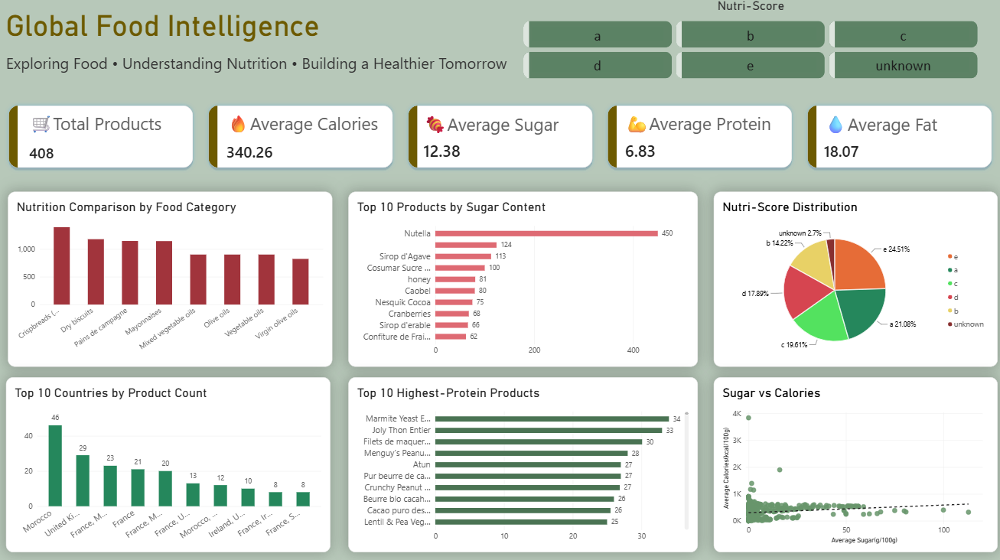

# global-food-intelligence
An end-to-end data engineering pipeline for food and nutrition analytics using Python, Open Food Facts API, MySQL, SQL, and Power BI.

#  Global Food Intelligence Pipeline

### An End-to-End Data Engineering & Analytics Pipeline for Nutrition Data

[](https://python.org)
[](https://mysql.com)
[](https://microsoft.com)

##  Project Overview
Global Food Intelligence is an end-to-end data engineering pipeline designed to ingest, clean, model, and visualize food product data. By extracting raw, deeply nested JSON records from the public **Open Food Facts API**, the pipeline automates data transformation through an **ETL (Extract, Transform, Load)** workflow, storing relational data in **MySQL** and delivering production-ready business intelligence via **Power BI**.

---

##  System Architecture & Data Flow

`Open Food Facts API` ➔ `Python (Requests)` ➔ `Raw JSON staging` ➔ `Pandas Cleaning & Typing` ➔ `MySQL Relational Storage` ➔ `SQL Aggregations & Transformations` ➔ `Power BI Interactive Dashboard`

---

##  Technical Stack & Implementation Details

* **Data Ingestion (Python & Requests):** Formatted dynamic API queries to extract multi-country product information, handling raw nested JSON payloads.
* **Data Cleansing & Preprocessing (Pandas):** Implemented data-type enforcement, isolated relevant nutritional matrices (calories, sugars, proteins), handled structural inconsistencies, and exported deterministic CSV states.
* **Relational Database Management (MySQL):** Designed and deployed a normalized schema optimized for analytical query execution.
* **Data Transformation (Advanced SQL):** Developed performant analytical queries leveraging aggregate functions, conditional filtering, and ranking windows to isolate key nutritional distributions.
* **Business Intelligence (Power BI):** Designed a high-fidelity dashboard incorporating advanced DAX measures, dynamic filtering, and custom-styled KPI components.

---

##  Analytics Framework (SQL)
The pipeline computes six core analytical views within the database layer:
* **Nutritional Density Matrix:** Comparative analysis of average calories, sugar, fat, and protein across discrete food categories.
* **Outlier Analysis (Sugar/Protein):** Isolation queries identifying the top 10 highest-sugar and highest-protein products using structured sorting.
* **Nutri-Score Distribution Profiles:** Frequency metrics tracking the distribution of recorded Nutri-Score grades (`A` through `E`).
* **Geographical Distribution:** Group-by aggregations identifying dominant market values across international boundaries.
* **Correlation Mapping:** Bivariate evaluation analyzing the relationship between sugar volume and overall calorie content.

---

##  Power BI Dashboard Preview




---

##  Repository Blueprint
```text
global-food-intelligence/
├── python/          # ETL pipelines and ingestion scripts
├── sql/             # DDL schemas, constraints, and analytical queries
├── data/            # Local staging data (staged raw JSON & cleaned target CSVs)
├── dashboard/       # .pbix source files and layout assets
├── REQUIREMENTS.txt # Python dependency configurations
└── README.md        # Technical documentation
```

---

##  Execution & Setup Guide

### 1. Environment Setup
Clone the repository and install the verified dependencies:
```bash
git clone https://github.com
cd global-food-intelligence
pip install -r requirements.txt
```

### 2. Database Initialization
1. Execute the schema initialization script located in `/sql` to create the target database and tables.
2. Run the Python ETL pipeline to populate the staging environment.
3. Execute the transformation scripts to prepare the reporting layer for Power BI connection.

---

##  Data Quality & Pipeline Constraints
* **Upstream Data Dependency:** Analytical accuracy is bound to the crowdsourced data integrity of the Open Food Facts ecosystem. Missing metrics are handled gracefully via pipeline exceptions.
* **Data Ingestion Truncation:** During the data loading phase, raw payload records with structural schema violations or data type incompatibilities were strictly filtered to enforce strict database constraints, resulting in 408 verified reporting records.
* **Geographical Strings:** Country-level data features multi-value entries; counts reflect instance presence rather than completely normalized geopolitical boundaries.

---

##  Author
**Disha**  
*B.Sc. Data Science (Third Year Student)*  
Specializing in Data Engineering Pipelines & Relational Analytics.

